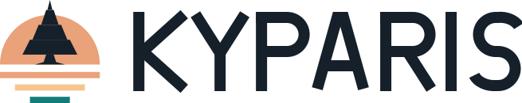

<picture>
  <source media="(prefers-color-scheme: dark)"
          srcset="https://raw.githubusercontent.com/kyparis-studio/.github/main/profile/brand/lockup-limestone.svg">
  
</picture>

### Hard work on things that matter.

Kyparis is a small studio that builds games, productivity apps, and business
software, and ships them. It is Kevin Holloway's studio, from Gainesville, Florida.

The name is from the Greek *kyparissos* (κυπάρισσος), the cypress: the bald
cypress of the swamps around Gainesville, rooted in water and standing for
centuries. A cypress does not choose the flood; it chooses to hold its ground,
and it keeps growing.

**In beta**: [Undercrew](https://kyparis-studio.github.io/undercrew/), a
Terraria-deep 2D sandbox you never directly play. You run the crew of agents
that plays it, from your phone. In beta on TestFlight.

Most repos here are private. [The studio site](https://kyparis-studio.github.io) is
the front door.

`29°39′N  82°19′W`
